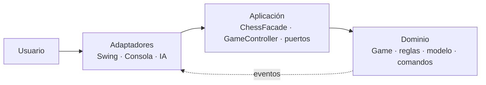

# TPO Ingeniería de Software — Ajedrez en Java

Aplicación de ajedrez para jugar entre dos personas o contra una IA. Incluye una interfaz gráfica de escritorio hecha con Swing y una alternativa por consola. El motor aplica las reglas principales del juego: jaque, jaque mate, ahogado, enroque, captura al paso, coronación, tablas, rendición, historial y deshacer/rehacer.

## Empezar a jugar

Estas instrucciones parten de que ya tenés la carpeta del proyecto —porque clonaste el repositorio o descargaste y descomprimiste el código—. No necesitás instalar Maven: el proyecto trae su propio ejecutable (`mvnw`).

### 1. Instalar y comprobar Java

Instalá un **JDK 21 o superior**. Es importante que sea un JDK, no solamente un JRE. Después abrí una terminal y ejecutá:

```text
java -version
```

La salida debe indicar versión `21` o posterior. Si el comando no existe o muestra una versión anterior, instalá/configurá Java antes de continuar.

- **Windows:** instalá un JDK 21 y, durante la instalación, habilitá la opción para agregar Java al `PATH`. Cerrá y volvé a abrir PowerShell o Símbolo del sistema antes de ejecutar `java -version`.
- **macOS:** instalá un JDK 21 para macOS y abrí de nuevo Terminal. Si hay varias versiones instaladas, verificá que `java -version` use la 21 o superior.
- **Linux:** instalá el paquete `openjdk-21-jdk` (o el equivalente de tu distribución). El script de construcción también usa `curl` y `unzip`; instalalos si no están disponibles.

La primera compilación requiere conexión a Internet: el wrapper descarga Maven 3.9.9 una sola vez y Maven descarga las dependencias de prueba. Luego se guardan en el equipo para los siguientes usos.

### 2. Compilar y abrir el juego

Abrí una terminal en la carpeta raíz del proyecto, entrá en `backend` y ejecutá los comandos correspondientes a tu sistema. El comando de compilación también ejecuta los tests y crea el archivo jugable `target/chess.jar`.

#### Windows

En **Símbolo del sistema (cmd)**:

```bat
cd ruta\a\TPO_IngenieriaDeSoftware\backend
java -version
mvnw.cmd package
java -jar target\chess.jar
```

En **PowerShell**, el segundo comando es `./mvnw.cmd package`.

#### macOS

```bash
cd /ruta/a/TPO_IngenieriaDeSoftware/backend
java -version
./mvnw package
java -jar target/chess.jar
```

#### Linux

```bash
cd /ruta/a/TPO_IngenieriaDeSoftware/backend
java -version
./mvnw package
java -jar target/chess.jar
```

Si macOS o Linux muestra `Permission denied` al usar `./mvnw`, ejecutá una sola vez `chmod +x mvnw` y repetí el comando. Si querés comprobar únicamente las pruebas, usá `./mvnw test` en macOS/Linux o `mvnw.cmd test` en Windows.

### 3. Elegir partida y mover piezas

Al abrir el JAR se muestra el menú gráfico. Elegí el modo de juego, escribí los nombres si querés y presioná **Comenzar partida**.

1. Elegí **Humano vs. humano**, **Humano (blancas) vs. IA** o **IA (blancas) vs. humano**.
2. Si hay IA, elegí la dificultad: fácil (aleatoria), media (prioriza material) o difícil (minimax).
3. Para mover, hacé clic en una pieza y luego en su casilla de destino; también podés arrastrarla y soltarla. El tablero indica los destinos legales, la última jugada y un rey en jaque.
4. Usá los botones inferiores para deshacer, rehacer, ofrecer tablas, rendirte o empezar una partida nueva. Al coronar un peón, elegí la pieza en el cuadro de diálogo.

Para abrir la versión de texto en lugar de la gráfica, agregá `--console`:

```bash
java -jar target/chess.jar --console
```

En la consola, por ejemplo, `e2 e4` mueve un peón, `O-O` hace enroque corto, `movs e2` muestra destinos, y `deshacer`, `rehacer`, `tablas`, `rendirse` y `salir` controlan la partida.

## Estructura del proyecto

```text
.
├── backend/
│   ├── mvnw, mvnw.cmd               # Maven Wrapper para macOS/Linux y Windows
│   ├── pom.xml                      # Compilación Java 21, JAR ejecutable y pruebas
│   └── src/
│       ├── main/
│       │   ├── java/chess/
│       │   │   ├── Main.java         # Punto de entrada; selecciona UI gráfica o consola
│       │   │   ├── domain/           # Reglas y modelo de ajedrez, independiente de la UI
│       │   │   ├── application/      # Casos de uso, fachada y puertos
│       │   │   └── adapters/         # Consola, Swing e IA
│       │   └── resources/chess/adapters/swing/
│       │       └── pieces-sprite.png # Imágenes de las piezas del tablero
│       └── test/java/chess/          # Pruebas unitarias y de integración
└── docs/
    ├── arquitectura.md               # Mapa detallado de conceptos y optimizaciones
    ├── requisitos.md                 # Requisitos funcionales y no funcionales
    ├── reglamento.md                 # Reglas de ajedrez contempladas
    └── gobernanza.md                 # Convenciones, ramas y riesgos
```

## Arquitectura y decisiones de diseño

El proyecto usa una arquitectura hexagonal simplificada, organizada en capas. La regla principal es que el dominio no conoce ni la interfaz gráfica, ni la consola, ni la IA: contiene únicamente el modelo y las reglas de ajedrez. Las dependencias van hacia el centro.



| Capa | Responsabilidad | Ejemplos |
|---|---|---|
| `domain` | Representa el negocio y hace cumplir las reglas. No depende de interfaces de usuario. | `Game`, `Board`, `Move`, `MoveGenerator`, `CheckDetector`, `GameEndDetector` |
| `application` | Expone operaciones para jugar y coordina participantes sin saber si son humanos o IA. | `ChessFacade`, `GameController`, `MoveParser`, puerto `Player` |
| `adapters` | Traduce la interacción de cada tecnología a operaciones de la aplicación y presenta el resultado. | `SwingApp`, `ConsoleApp`, `AiPlayer` y las estrategias de IA |
| `Main` | Es el punto de entrada: abre Swing si hay entorno gráfico y no se pasan argumentos; con un argumento, como `--console`, usa la consola. | `chess.Main` |

Las decisiones más importantes son:

- **Reglas aisladas de la presentación.** Una jugada se valida en `MoveGenerator` y `Game`; Swing solo pinta el tablero y la consola solo lee/escribe texto. Esto permite cambiar o agregar una interfaz sin reescribir las reglas.
- **Una API pequeña para las interfaces.** `ChessFacade` concentra acciones como `play`, `undo`, `redo`, `resign`, `legalTargetsFrom` y consultas del estado. Así las interfaces no necesitan coordinar directamente comandos, estados y validaciones.
- **Estado del tablero separado de la lógica.** `Board` guarda piezas, derechos de enroque, captura al paso y contador de cincuenta jugadas; los detectores y generadores resuelven qué se puede hacer o cuándo termina la partida.
- **Dos formas de jugar sin duplicar el motor.** La UI Swing es la predeterminada y la consola es alternativa; ambas reutilizan el mismo dominio. La IA se presenta como otro jugador y no como una regla especial de la interfaz.
- **Testabilidad y encapsulación.** Las dependencias clave se reciben por constructor y los tests inyectan implementaciones controladas. Las interfaces y la IA reciben una copia del tablero (`boardSnapshot`), por lo que no pueden modificar la partida real.
- **Uso eficiente del motor.** Las piezas y posiciones se reutilizan, las jugadas se aplican y revierten con `MoveCommand` durante la búsqueda y la IA difícil usa poda alfa-beta, ordenamiento de capturas y profundización iterativa con un presupuesto de tiempo.

## Patrones de diseño utilizados

| Patrón | Implementación | Para qué se usa |
|---|---|---|
| **Strategy** | `MovementPattern` y sus implementaciones; `AiStrategy` con `RandomStrategy`, `GreedyStrategy` y `MinimaxStrategy` | Cambiar cómo se mueve una pieza o cómo decide la IA sin cambiar el resto del motor. |
| **State** | `GameState`, `WhiteTurnState`, `BlackTurnState`, `GameOverState` | Cada estado decide qué jugadas acepta y cuál es la transición siguiente; evita condicionales de turno repartidos. |
| **Command** | `Command`, `MoveCommand`, `CommandHistory` | Ejecutar, deshacer y rehacer jugadas. También permite simular una jugada y revertirla al validar legalidad o buscar la respuesta de la IA. |
| **Observer** | `GameEventListener`, `MoveEvent`, listeners de consola y Swing | El dominio comunica jugadas, jaques, deshacer y fin de partida sin conocer a la interfaz que los muestra. |
| **Factory** | `PieceFactory`, `BoardFactory`, `AiStrategyFactory` | Centralizar la creación de piezas, posiciones iniciales/FEN y estrategias según dificultad. |
| **Facade** | `ChessFacade` | Dar una entrada simple y estable a las interfaces, ocultando reglas, estado, historial y parseo. |
| **Template Method** | `TurnState.play()` | Define el algoritmo común de un turno; cada subtipo aporta el color y el turno oponente. |

Además, las piezas se modelan por **composición antes que herencia**: `Piece` tiene un `MovementPattern`; por ejemplo, la dama combina los movimientos de torre y alfil mediante `CompositeMovement`, en vez de requerir una jerarquía rígida de subclases.

## Principios SOLID aplicados

| Principio | Evidencia en el proyecto |
|---|---|
| **S — Responsabilidad única** | `Board` conserva estado; `MoveGenerator` genera jugadas; `CheckDetector` detecta jaques; `GameEndDetector` resuelve finales; `MoveParser` transforma texto; cada UI se encarga de presentar e interactuar. |
| **O — Abierto/cerrado** | Las reglas de movimiento se extienden mediante nuevas implementaciones de `MovementPattern`, y los niveles de IA mediante `AiStrategy`, sin modificar el generador de jugadas ni quien consume la estrategia. |
| **L — Sustitución de Liskov** | Cualquier `MovementPattern` puede usarse en una `Piece` y cualquier `AiStrategy` puede seleccionarse para la IA, respetando el mismo contrato. |
| **I — Segregación de interfaces** | `Player` describe las acciones de quien juega y `GameEventListener` describe notificaciones. Un listener implementa solo los eventos que necesita gracias a métodos `default`. |
| **D — Inversión de dependencias** | `Game`, `GameController` y las estrategias reciben colaboradores por constructor y dependen de abstracciones como `Player`, `GameEventListener` y `AiStrategy`. Esto desacopla las políticas del dominio de los detalles de UI e IA. |

## Calidad y pruebas

Las pruebas se ejecutan con `mvnw test` y cubren, entre otros aspectos:

- movimientos de cada pieza y posiciones especiales;
- jaque, mate, ahogado, triple repetición, regla de 50 jugadas, tablas y rendición;
- enroque, captura al paso y coronación;
- invariante de `MoveCommand`: deshacer deja el tablero igual que antes de ejecutar;
- conteos *perft* para validar generación de jugadas;
- parseo, control de partida y los tres niveles de IA, incluido el límite de tiempo de minimax.

Para una explicación clase por clase y de las optimizaciones, consultá [docs/arquitectura.md](docs/arquitectura.md).
