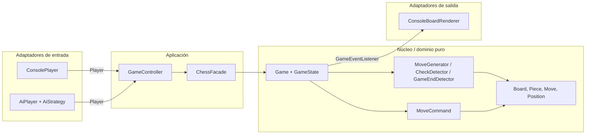

# Arquitectura y conceptos de la materia aplicados

> Ruta base del código: `backend/src/main/java/chess/` (abreviada como `chess/`).

## 1. Arquitectura hexagonal (Unidad 00.1 y 01)

- **Núcleo** (`chess/domain`): reglas del ajedrez. No importa nada de consola ni de IA, así que se testea sin UI.
- **Puertos**:
  - `Player` (`chess/application/port`) es el puerto de entrada: alguien que decide la jugada.
  - `GameEventListener` (`chess/domain/event`) es el puerto de salida: alguien que se entera de lo que pasa.
- **Adaptadores** (`chess/adapters`): la consola y la IA. Para agregar una UI web alcanza con escribir otro adaptador; el núcleo no se toca.
- **Regla de dependencias**: `adapters → application → domain`, nunca al revés.
- **Composition root**: `chess/Main.java` y `ConsoleApp` son los únicos lugares que hacen `new` de implementaciones concretas.

## 2. Mapa concepto → código

| Concepto (unidad) | Dónde | Qué hace |
|---|---|---|
| Requisitos funcionales y no funcionales (U01) | [`requisitos.md`](requisitos.md) | Qué hace el sistema y con qué calidad. |
| **S**RP (U01) | `Board` (estado), `MoveGenerator` (genera jugadas), `CheckDetector` (jaque), `GameEndDetector` (finales), `MoveParser` (texto → jugada), `ConsoleBoardRenderer` (dibujo) | Cada clase tiene una sola razón para cambiar. |
| **O**CP (U01) | `domain/movement/MovementPattern` | Para una pieza nueva se compone un patrón nuevo, sin modificar `MoveGenerator`. |
| **L**SP (U01) | Implementaciones de `MovementPattern` y de `AiStrategy` | Todas cumplen el mismo contrato (Javadoc de la interfaz) y son intercambiables. |
| **I**SP (U01) | `Player` separado de `GameEventListener`; el listener tiene métodos `default` | El renderer no implementa la entrada de jugadas y un listener implementa solo los eventos que le interesan. |
| **D**IP + inyección de dependencias (U01) | `Game(board, side, MoveGenerator, GameEndDetector)`, `GameController(facade, white, black)`, `RandomStrategy(gen, Random)` | Las dependencias entran por constructor. En los tests se inyectan *fakes* (`ScriptedPlayer`, `RecordingListener`, `Random(42)`). |
| Composición sobre herencia (U01) | `Piece` es `final` y tiene un `MovementPattern`; `CompositeMovement(rook, bishop)` es la Dama | No hay jerarquía de 6 subclases de pieza. La Dama "es" Torre + Alfil por composición. |
| **Strategy** (U00, U01) | `MovementPattern`: `SlidingMovement`, `JumpMovement`, `PawnMovement`, `CompositeMovement` | Cómo se mueve cada pieza. |
| **Strategy** (U01, U05) | `AiStrategy`: `RandomStrategy` (fácil), `GreedyStrategy` (media), `MinimaxStrategy` (difícil) | La dificultad de la IA se elige en tiempo de ejecución. |
| **State** (U01 clase 3) | `domain/game`: `GameState`, `TurnState`, **`WhiteTurnState`** (turno de las blancas), **`BlackTurnState`** (turno de las negras), `GameOverState` (mate, tablas o rendición) | Cada estado decide si acepta la jugada y a qué estado pasa (`TurnState.next`). No hay `if (turno == BLANCAS)` desparramados. |
| **Command** (U01 clase 3) | `domain/command`: `Command`, `MoveCommand` (`execute`/`undo`), `CommandHistory` | Deshacer/rehacer. También se usa para filtrar jugadas que dejan al rey en jaque y en la búsqueda de la IA. |
| **Observer** (U00, U01) | `GameEventListener`, `MoveEvent`; `Game.addListener/removeListener`; implementa `ConsoleBoardRenderer` | El núcleo avisa jugada, jaque, deshacer y fin de partida, sin saber quién escucha. |
| **Factory** (U00, U01) | `PieceFactory` (pieza ↔ patrón), `BoardFactory` (posición inicial y FEN), `AiStrategyFactory` (dificultad → strategy) | Centraliza la creación. La coronación usa `PieceFactory`. |
| **Facade** (U00) | `application/ChessFacade` | API simple para la UI: `play("e2 e4")`, `undo()`, `legalTargetsFrom("e2")`... |
| Template Method (extra) | `TurnState.play()` con `color()`/`opponentTurn()` abstractos | El algoritmo del turno es común; las subclases ponen los detalles. |
| Testing: pirámide, AAA, fakes (U01 clase 4) | `backend/src/test` | Ver sección 3. |
| Walking skeleton / ágil (U01 clase 4) | Orden de construcción: peón que avanza → todas las piezas → jaque → mate → especiales → undo → tablas → IA | Cada paso quedó jugable de punta a punta. |
| Optimización de CPU (U04) | Ver sección 4 | Big O, caching, precomputación, cortocircuito, poda. |
| Optimización de RAM (U04 parte 2) | Ver sección 4 | Make/unmake, piezas compartidas, memory leaks. |
| SLA como contrato / interfaz (U03) | `AiStrategy.timeBudgetMillis()` y `AiStrategyTest.hardAiRespectsItsTimeBudget` | La IA "se compromete" a responder en ≤ 2 s y un test lo verifica (`assertTimeoutPreemptively`). |
| Gobernanza, políticas y riesgos (U05) | [`gobernanza.md`](gobernanza.md) | Convenciones, política de ramas y registro de riesgos del TPO. |

## 3. Tests (pirámide)

| Nivel | Clase de test | Qué prueba |
|---|---|---|
| Unitario | `PositionTest`, `PieceMovementTest` | Cada pieza (cada `MovementPattern`) aislada. |
| Unitario | `SpecialMovesTest` | Clavadas, salir del jaque, enroque (todas sus condiciones), captura al paso y coronación. |
| Unitario | `MoveCommandTest` | Invariante del Command: *antes de execute == después de undo* para todas las jugadas de varias posiciones. |
| Unitario / integración | `GameTest` | Transiciones del State; Observer (`RecordingListener`); mate del loco, ahogado, material insuficiente, triple repetición, 50 jugadas, rendición, acuerdo, undo/redo. |
| Integración | `PerftTest` | Cuenta todas las jugadas legales hasta profundidad N y compara con valores publicados (posición inicial a prof. 4 = 197.281). Detecta cualquier error de reglas. |
| Aplicación | `MoveParserTest`, `GameControllerTest` | Parseo de jugadas y bucle de juego con jugadores *fake* guionados. |
| IA | `AiStrategyTest` | Las 3 dificultades juegan legal, greedy captura la dama colgada, minimax encuentra mate en 1, se respeta el tiempo comprometido. |

Todos siguen **Arrange / Act / Assert**. Las posiciones se arman con FEN (`BoardFactory.fromFen`) para ir directo al caso que se quiere probar.

## 4. Optimización (Unidad 04)

| Técnica | Dónde | Efecto |
|---|---|---|
| Caching | `Position.of()` devuelve una de 64 instancias precreadas; `PieceFactory` comparte las 12 piezas | Menos objetos y menos trabajo del GC. |
| Precomputación / lookup table | `JumpMovement` calcula los destinos de caballo y rey para las 64 casillas en el constructor | Generar saltos es recorrer una lista ya armada; `attacks()` es O(1). |
| Cortocircuito | `MoveGenerator.hasAnyLegalMove` corta en la primera jugada legal | Detectar mate/ahogado no genera todas las jugadas. |
| Poda alfa-beta + ordenamiento | `MinimaxStrategy` | De O(b^d) a ~O(b^(d/2)) nodos; las capturas se prueban primero para podar antes. `lastSearchNodes()` permite medirlo. |
| Profundización iterativa con presupuesto | `MinimaxStrategy.chooseMove` | Cumple el tiempo comprometido y siempre tiene una jugada lista. |
| Make/unmake en vez de copiar (RAM) | `MoveCommand` en `MoveGenerator.isLegal` y en la búsqueda de la IA | Un solo tablero en memoria durante toda la búsqueda; la IA copia una vez (`boardSnapshot`). |
| Reutilizar listas (RAM) | `MovementPattern.generate(..., List<Move> out)` | Todas las piezas agregan en una misma lista. |
| Evitar memory leaks | `Game.removeListener` (se llama al terminar `ConsoleApp`) | Un listener registrado mantiene vivo al objeto (lo visto en clase con eventos de C#). |
